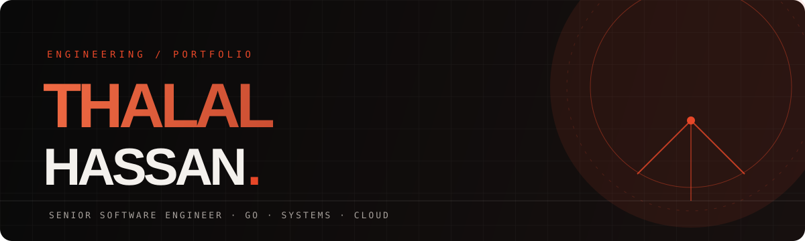

### SENIOR SOFTWARE ENGINEER · BACKEND & PLATFORM ENGINEERING

**Building reliable systems. Designing for scale. Engineering with intent.**

---

## 01 / About

I'm a **Senior Software Engineer** with 5+ years of experience building and shipping production software across backend, platform and full-stack engineering.

My work is centred on designing maintainable services, making sound architectural decisions and taking systems from an initial idea through to production. I've contributed as an individual engineer and technical lead across multi-tenant platforms, e-commerce, integrations and cloud-oriented systems.

- **Primary focus:** Go, backend architecture, distributed systems and high-concurrency services.
- **Backend:** API design, microservices, PostgreSQL, Redis, `sqlc` and GORM.
- **Platform & cloud:** AWS, Azure, GCP, Docker, Kubernetes and Terraform.
- **Full-stack:** React, TypeScript, Node.js and NestJS.
- **Currently exploring:** Cloud infrastructure automation and practical AI integration.

I care about the engineering behind the feature: clear boundaries, data consistency, observability, operational resilience and code that teams can confidently maintain.

## 02 / Engineering toolkit

| Domain | Technologies |
|---|---|
| Languages | **Go**, TypeScript, JavaScript, SQL |
| Backend | Go, Node.js, NestJS, Express, REST, gRPC |
| Frontend | React, Angular |
| Data | PostgreSQL, MongoDB, Redis, MySQL |
| Data access | sqlc, GORM, Prisma |
| Cloud & infrastructure | AWS, Azure, GCP, Docker, Kubernetes, Terraform |
| Platform & tooling | Git, Consul, Caddy, Linux |
| AI integrations | OpenAI API, Claude API |

## 03 / Selected work

### Low-Code Application Platform
**Technical Lead · 2022–2024**

Contributed to the architecture and delivery of a multi-tenant application platform, including service discovery, routing and AI-assisted application generation.

`Microservices` `Consul` `Caddy` `TypeScript` `React` `OpenAI API`

### Grocery Commerce Backend
**Independent engineering · 2025–present**

Building a backend foundation for grocery commerce with a focus on clear domain boundaries, reliable persistence and maintainable service interfaces.

`Go` `PostgreSQL` `sqlc` `Redis`

### Cloud DNS Engineering
**Multi-cloud infrastructure**

Working on DNS centralisation and cloud infrastructure automation across AWS, Azure and GCP. Public details are kept high-level where implementation specifics are not shareable.

`Go` `AWS` `Azure` `GCP` `Terraform` `Kubernetes`

### School Management Backend
**Independent engineering · 2025**

Developing a role-aware school management backend with structured domain models, access control and a maintainable service layer.

`Go` `GORM` `PostgreSQL` `RBAC`

### Earlier product work
- **E-Learning Platform** — Full-stack learning application with Node.js/Express APIs and a React administration experience.
- **Shopify Analytics Platform** — Data synchronisation from Shopify APIs into PostgreSQL with analytical REST endpoints.

## 04 / Recognition

- **Emerging Champion** — Neoito Annual Awards, 2022.
- **Standout Performer** — Neoito Start Awards, 2023.
- **Technical Lead** — Led engineering work on a multi-tenant low-code platform.
- **Production AI integration** — Integrated OpenAI APIs into an application-building workflow.
- **Systems research** — Explored Firecracker microVMs and hardware-enforced workload isolation.

## 05 / What I'm interested in

Backend and platform engineering problems involving service architecture, distributed systems, data-intensive applications, cloud infrastructure and developer tooling.

I'm particularly interested in teams that value engineering ownership, thoughtful trade-offs and reliable delivery.

## 06 / Let's connect

**Have an interesting engineering problem or product to build?**

[Portfolio](https://thalalhassan.github.io/) · [LinkedIn](https://www.linkedin.com/in/thalalhassan/) · [Email](mailto:thalal424@gmail.com)

*Kasaragod, Kerala, India*

---

© Thalal Hassan · Built with curiosity and an appreciation for well-engineered systems.

